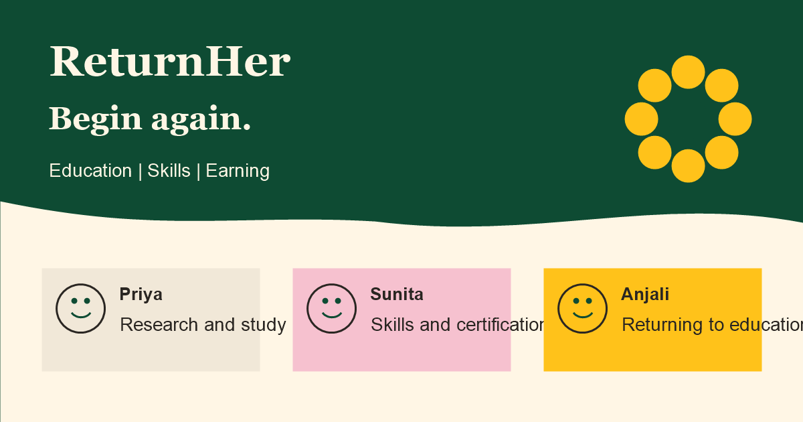

# ReturnHer

A local prototype for exploring education, skills, and earning pathways.

ReturnHer helps women explore sample government-supported pathways using their education, skills, goal, state, and district. It is a bilingual prototype and does not represent a government service.

Live demo: https://your-username.github.io/returnher/

Built for Hackathon Name, Month 2026.



## Problem

The prototype illustrates three fictional sample personas:

- Priya is a postgraduate interested in research and a PhD.
- Sunita has tailoring and embroidery experience and wants to certify her skills.
- Anjali is returning to education and wants to continue her studies.

## Features

- English and Hindi interface with a remembered language choice.
- Guided profile setup and sample personas.
- Personalized pathway suggestions and opportunity search.
- Opportunity details, eligibility guide, and application checklist.
- Local saved items and application progress.
- Scripted Sakhi helper with official source links.

## Run it

Clone the repository:

```text
git clone https://github.com/trishasinghof-art/ReturnHer
```

Open `index.html` in a modern browser. Add `#/kit` to the URL to see the illustrations.

## Stack

HTML, CSS, vanilla JavaScript, hash routing, localStorage, inline SVG, and Google Fonts.

## Matching

```text
Goal match: +3
Skills match: +2
Qualification meets minimum: +2
State match or All India: +1
Learning mode match: +1
Funding preference matches eligible funding type: +1

Filter out opportunities requiring a higher qualification.
Exclude distance and fully online PhD options because UGC rules do not permit them.
```

## Structure

```text
ReturnHer/
├── .gitignore
├── LICENSE
├── README.md
├── index.html
├── assets/
│   ├── favicon.svg
│   ├── og-image.png
│   └── illustrations/
│       ├── .gitkeep
│       ├── cta-panel.svg
│       ├── hero-crowd.svg
│       ├── sakhi.svg
│       ├── scene-doorway.svg
│       ├── scene-entrepreneur.svg
│       ├── scene-homeEarner.svg
│       ├── scene-learner.svg
│       ├── scene-scholar.svg
│       ├── scene-tailor.svg
│       └── scene-teacher.svg
├── css/
│   └── styles.css
├── docs/
│   └── design-brief.md
└── js/
    ├── app.js
    ├── data.js
    ├── i18n.js
    └── illustrations.js
```

## Sources

- IGNOU: https://ignou.ac.in
- National Institute of Open Schooling: https://nios.ac.in
- National Scholarship Portal: https://scholarships.gov.in
- UGC Distance Education Bureau: https://deb.ugc.ac.in
- Common Fellowship Portal: https://fellowships.gov.in
- National Career Service: https://ncs.gov.in
- Skill India Digital: https://skillindiadigital.gov.in
- Apprenticeship India: https://apprenticeshipindia.gov.in
- PM Vishwakarma: https://pmvishwakarma.gov.in
- MUDRA: https://mudra.org.in
- Stand-Up India: https://standupmitra.in
- Aajeevika: https://aajeevika.gov.in

## Limitations

- Sign-in is a demo flow; it does not authenticate users.
- Opportunity data is sample data and has no dates or amounts.
- Matching is rule-based.
- Sakhi uses keyword-based responses and does not use an external service.
- There is no backend.
- No Aadhaar, phone number, or address is collected.
- Answers stay in local browser storage and are never sent anywhere.

## Roadmap

- Add a verified opportunity database.
- Add real authentication.
- Include district-level centres.
- Add more languages.
- Validate the content with Jan Shikshan Sansthan (JSS) and self-help groups.

## License

MIT

Built by Trisha Singh, Team Hopeless03.
